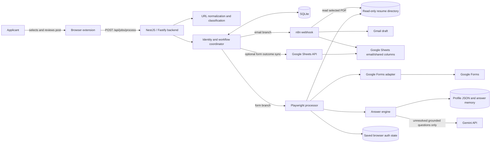
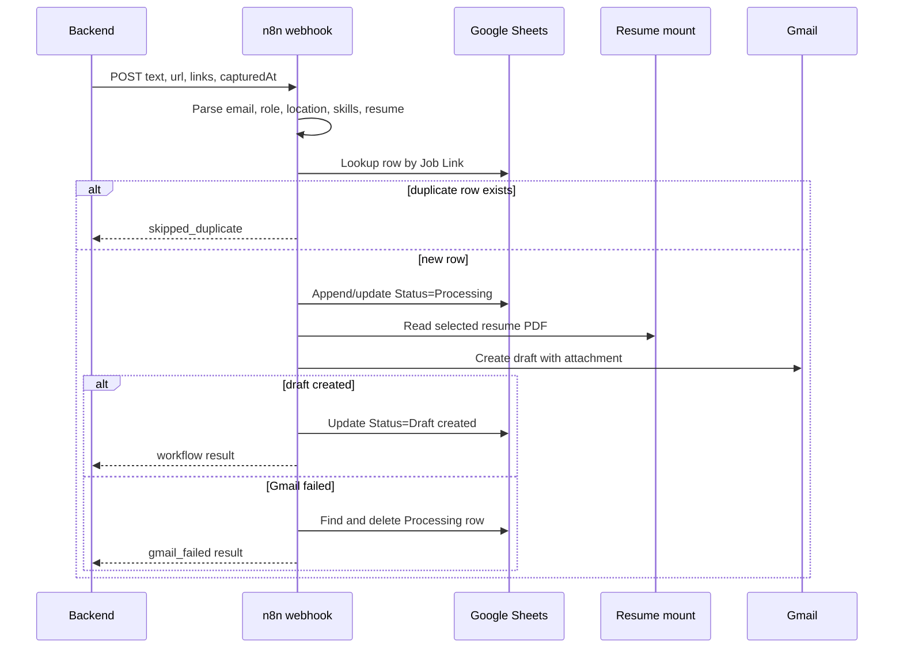
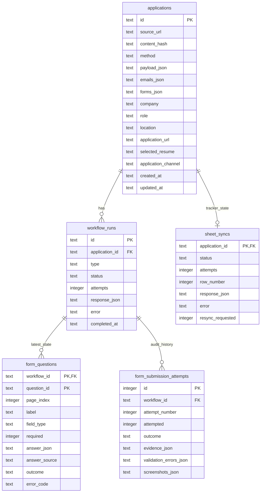

# LinkedIn job automation

This project is a local-first job-application assistant. A Firefox/Chrome extension captures one LinkedIn job post, a NestJS backend turns that capture into a durable application record, and independent email and form workflows prepare a Gmail draft or process an eligible Google Form. The system is intentionally conservative: it drafts email instead of sending it, requires explicit consent before submitting a form, stops on uncertain facts or unsupported controls, and never treats a click on **Submit** as proof of success.

The implementation is the source of truth for this document. In particular, the extension always calls the backend; the backend alone decides whether to invoke n8n, Playwright, both, or neither. The broad destination classifier recognizes several form/ATS URL patterns, but the only implemented browser adapter is Google Forms.

> **Personal-data warning:** `backend/data/profile.json` is version-controlled and contains the applicant profile and resume catalog. Replace or sanitize it before publishing a fork. Never commit API keys, OAuth data, browser storage state, service-account JSON, databases, screenshots, or resume files.

## Table of contents

- [Purpose and capabilities](#purpose-and-capabilities)
- [Current implementation status](#current-implementation-status)
- [Architecture](#architecture)
- [End-to-end workflows](#end-to-end-workflows)
- [Project structure](#project-structure)
- [Technology stack](#technology-stack)
- [Data model and persistence](#data-model-and-persistence)
- [Configuration reference](#configuration-reference)
- [Setup and operation](#setup-and-operation)
- [API reference](#api-reference)
- [Reliability and security](#reliability-and-security)
- [Testing](#testing)
- [Limits and troubleshooting](#limits-and-troubleshooting)

## Purpose and capabilities

The project reduces the repetitive parts of applying to jobs discovered on LinkedIn without turning uncertain decisions into silent automation. It solves four related problems:

1. **Capture:** reliably collect the selected post text, post permalink, visible URLs, clickable destinations, and email links despite LinkedIn DOM changes.
2. **Routing and idempotency:** normalize destinations, classify email and form channels, assign stable identifiers, persist state, and avoid repeat drafts or submissions.
3. **Application assistance:** create a Gmail draft with a role-matched resume through n8n, or fill a supported Google Form with profile-grounded answers through Playwright.
4. **Audit and tracking:** retain workflow outcomes, normalized answers and provenance, form attempts, confirmation evidence, failures, and optional Google Sheets synchronization.

### What is automated

- Capturing one selected or unambiguous visible LinkedIn post and presenting it for review.
- Extracting `http://`, `https://`, `www.`, `mailto:`, clickable external anchors, LinkedIn redirect targets, and `lnkd.in` links.
- Canonicalizing URLs, removing common tracking parameters, resolving LinkedIn short links under an SSRF policy, and deduplicating destinations.
- Detecting email addresses, including common `[at]` and `[dot]` obfuscation, and detecting likely application-form/ATS URLs.
- Creating one durable application plus independent email and form workflow records.
- Calling n8n for email applications. The imported workflow extracts role metadata, selects a resume, writes a tracker row, reads the resume file, and creates a **Gmail draft**.
- Inspecting, answering, validating, navigating, attaching files to, and—when explicitly enabled—submitting one Google Forms application.
- Reusing a saved Google/SSO browser session without storing the user's password.
- Optionally reconciling backend-owned form columns into Google Sheets.

### What remains manual

- Selecting the correct LinkedIn post and reviewing/editing the popup payload before clicking **Send**.
- Reviewing and sending the Gmail draft. The n8n workflow does not send email.
- Resolving ambiguous posts, multiple application forms, multiple email recipients that the imported n8n parser cannot safely choose, unknown roles, weak resume matches, or image-only advertisements.
- Supplying and verifying profile facts, salary data, resume files, application documents, and legal-declaration consent.
- Completing CAPTCHA, first-time/expired authentication, inaccessible forms, unsupported form controls, payments, fees, or any workflow that ends in `needs_manual_action`.
- Investigating `submission_unknown`. The application may already have been submitted, so the system will not retry it automatically.
- Configuring Gmail and Google Sheets credentials in n8n, and configuring a service account when backend-owned form synchronization is enabled.

## Current implementation status

| Area | State | Implementation notes |
|---|---|---|
| Browser capture | Implemented | Manifest V3 extension for Firefox and Chromium; LinkedIn content script plus `activeTab` fallback injection on regular HTTP/HTTPS pages. |
| Backend API | Implemented | NestJS 11 on Fastify, DTO validation, structured errors, optional API key, extension-only CORS, 1 MiB request limit. |
| URL safety | Implemented | Canonicalization, tracking-parameter removal, LinkedIn redirect/short-link handling, DNS checks, redirect/body/time limits. |
| Classification | Implemented, rule-based | Email and broad form/ATS recognition. Classification does not guarantee an automation adapter exists. |
| Durable identity and deduplication | Implemented | LinkedIn activity ID, canonical permalink hash, or content hash; independent deterministic email/form workflow IDs. |
| Email workflow | Implemented through n8n | Creates a Gmail draft with an attachment and updates the tracker; it never sends the draft. Live behavior depends on imported workflow credentials and file mounts. |
| Google Forms automation | Implemented with safety gates | Text, long text, number, date, radio, checkbox, select, multi-page navigation, and file upload. |
| Other form/ATS platforms | Classified but not automated | They are recorded as form workflows and return `needs_manual_action` with `unsupported_platform`. |
| Profile answer engine | Implemented | Verified profile → approved memory → deterministic derivation → Gemini → unresolved. |
| Persistent form authentication | Implemented | Playwright storage state; recommended Fedora flow captures a dedicated normal-Chrome session over loopback CDP. |
| SQLite audit history | Implemented | Application, workflow, latest question/answer, immutable attempt, and Sheets-sync records with startup migrations. |
| Backend Google Sheets sync | Implemented, opt-in | Uses a service account or short-lived access token and owns form-specific columns only. |
| Automated tests | Implemented | Unit/integration-style Jest tests and disposable loopback mock forms; no live Gmail, Sheets, Gemini, or real application submission tests. |
| Extension distribution | Development-only | Firefox loading is temporary; Chromium uses unpacked developer mode. No signing/store packaging exists. |

Two similarly named parser artifacts are present. `workflow.json` contains the parser that actually runs after that workflow is imported. `extract.js` is a newer standalone n8n Code-node parser (v0.6.0) with richer multi-role and resume scoring, but it is **not wired into `workflow.json` automatically**. Updating `extract.js` alone does not change the imported workflow.

## Architecture

### System view



### Component responsibilities

| Component | Responsibility | Does not do |
|---|---|---|
| Browser extension | Associates a selection with one post, extracts text/permalink/links, lets the user edit the capture, stores backend URL/token locally, and sends one request. | It does not classify, resolve short URLs, call n8n directly, or submit applications. |
| NestJS backend | Validates requests, normalizes and resolves URLs, classifies channels, creates durable identities, coordinates independent workflows, exposes status/auth/answer APIs, and synchronizes form outcomes. | It does not create or send Gmail messages itself. |
| n8n workflow | Parses email-application metadata, selects a resume, checks the tracker by `Job Link`, creates a Gmail draft, and updates/removes its tracker row. | It does not send the email and does not run Playwright. |
| Playwright processor | Runs one isolated browser context per form job, applies network policy, uses the platform adapter, answers/fills/validates pages, attaches approved files, and verifies submission. | It does not bypass CAPTCHA or guess required facts. |
| Google Forms adapter | Recognizes Google Forms, inspects controls, detects blockers, performs interactions, validates the page, and detects confirmation evidence. | It does not support Microsoft Forms, Typeform, Workday, or other classified destinations. |
| Answer engine | Matches questions to verified fields, reuses compatible answers, derives deterministic values, selects a resume, and invokes Gemini only for unresolved questions. | It does not allow Gemini to invent sensitive facts or legal consent. |
| SQLite | Stores the system of record for backend applications, workflows, form questions, attempts, and tracker synchronization. | It does not contain n8n's OAuth credentials, which stay in n8n's own volume. |
| Google Sheets | Acts as a human-readable tracker. n8n owns email/shared workflow updates; the backend optionally owns form-specific columns. | It is not the backend's idempotency database. |

### Trust and deployment boundaries

- The extension accepts only `http://localhost` or `http://127.0.0.1` backend process URLs and only the `/api/jobs/process` path.
- Direct development binds to `127.0.0.1` by default. Compose binds the container to `0.0.0.0` internally but publishes ports 3000 and 5678 only on host loopback.
- n8n is an internal local destination from the backend's perspective; `N8N_WEBHOOK_URL` only accepts `localhost`, `127.0.0.1`, or the Compose hostname `n8n` over HTTP.
- External form, Gemini, OAuth, and Sheets traffic leaves the machine. Browser requests to private, loopback, link-local, reserved, `.local`, and `.internal` destinations are blocked except for explicitly enabled test fixtures.
- The SQLite database, n8n volume, applicant profile, resume directory, browser storage state, and failure screenshots all contain sensitive application data and must be treated accordingly.

## End-to-end workflows

### 1. Capture and preview a job post

1. The user expands LinkedIn's “see more” content and selects text inside one post.
2. The content script remembers the selection before the popup takes focus. It looks for stable LinkedIn post containers, and falls back to a bounded selection container when LinkedIn markup has changed.
3. If there is no selection, capture is allowed only when exactly one substantial post is visible. Multiple visible posts are treated as ambiguous.
4. The script prefers the selected text, derives a stable post permalink from a post anchor or activity URN, and scans visible text and anchors for application links.
5. LinkedIn redirect wrappers exposed in the DOM are unwrapped, fragments/default ports are removed, and duplicate links are collapsed for preview.
6. The popup remains editable. Nothing is sent until the user clicks **Send**. On older tabs, the popup may inject the current content script once using `activeTab` permission.
7. The popup sends exactly `text`, `url`, `links`, and a new client-side `capturedAt` timestamp. Optional `company`, `role`, and `location` are API features, but the current popup does not send them.

The popup waits up to 180 seconds for the synchronous processing response. Closing it does not cancel already-persisted backend work, but it removes the immediate result view; query the returned/stable application ID later through the status endpoint.

### 2. Normalize, resolve, and classify destinations

The backend combines popup links with URLs found in the post text, then:

- trims surrounding punctuation and accepts only `http`, `https`, and valid `mailto` addresses;
- rejects credential-bearing URLs;
- lowercases email addresses, removes URL fragments and default ports, sorts query parameters, and removes `utm_*`, `trk`, `trackingid`, `fbclid`, and `gclid`;
- unwraps recognized LinkedIn `/redir/redirect` and `/safety/go` URLs only after validating the external destination;
- resolves only `lnkd.in` short URLs, with a global timeout, at most five hops, manual redirect handling, HTTPS-only public destinations, DNS/private-range checks, and a 256 KiB interstitial limit;
- reads LinkedIn's explicitly marked external link from a safety interstitial; resolution failure leaves the original `lnkd.in` URL in place;
- deduplicates normalized destinations while ignoring only a trailing slash for the comparison key.

The classifier then extracts deobfuscated email addresses and marks URLs matching common form/ATS patterns. Its result is one of:

- `email` — at least one email and no recognized form URL;
- `form` — at least one recognized form URL and no email;
- `email_and_form` — both branches are present;
- `needs_review` — no recognized destination. The application is still stored, but no workflow is created.

Recognition is deliberately broader than execution. For example, Typeform, Workday, Lever, Greenhouse, Microsoft Forms, and `/apply` URLs can produce the `form` classification, but currently stop because no adapter supports them.

### 3. Generate application and workflow IDs

The identity service chooses the strongest available source:

1. A LinkedIn activity ID from `urn:li:activity:<digits>` or a supported `/posts/...-<digits>` permalink produces `linkedin:activity:<digits>`.
2. A supported LinkedIn `/feed/update/`, `/posts/`, or `/pulse/` URL is stripped of query/fragment data and hashed into `linkedin:permalink:<32 hex characters>`.
3. Otherwise a SHA-256 fingerprint of normalized post text plus sorted normalized destinations produces `content:<64 hex characters>`.

The backend always computes and stores a separate `contentHash`, even when the application ID comes from LinkedIn. Email and form workflow IDs are SHA-256 hashes of `workflow-v1|<applicationId>|<type>`. SQLite enforces one workflow of each type per application.

This means the backend's unit of identity is normally the LinkedIn post, not each role inside a multi-role advertisement. The richer standalone `extract.js` can describe multiple role options for n8n, but that does not create multiple backend application records.

### 4. Duplicate detection and retry decisions

`INSERT OR IGNORE` plus primary/unique keys makes application and workflow creation atomic. On a repeated capture:

- a completed email workflow is reused and marked `duplicate: true` without calling n8n;
- a processing/pending email workflow is returned as-is;
- a failed email workflow is atomically claimed and retried;
- a completed form workflow is reused;
- a failed or `needs_manual_action` form is retried only when its recorded response does not say submission was attempted;
- `submission_unknown`, or any manual/failed outcome after submission began, is never retried automatically;
- email and form decisions are independent, so one branch can be reused while the other runs or fails;
- the top-level `duplicate` is true only when every returned branch is both completed and reused.

n8n performs a second, tracker-level duplicate check by the original LinkedIn `Job Link`. A 2xx n8n response with `status: skipped_duplicate` completes the backend email workflow with outcome `skipped_duplicate`. The backend records the n8n result but does not reinterpret its business status.

### 5. Email application through n8n



The backend forwards the normalized four-field webhook contract unchanged. The current imported workflow:

- validates post text, extracts email/form candidates and job metadata, and chooses a resume from paths inside `/files/resumes`;
- expects exactly one usable application recipient before it can construct `emailDraft` safely;
- creates a tracker row with `Processing` status before Gmail work;
- reads the selected resume file through n8n's file node;
- calls Gmail's **draft** resource with the resume attached;
- updates the row to `Draft created` on success;
- uses Gmail's error output to remove the temporary processing row and return `gmail_failed` on failure.

There is no automatic send node. Open Gmail, review recipient, subject, body, and attachment, then send manually. The n8n workflow contains credential references from its source environment; after import, map the Gmail and Google Sheets nodes to credentials owned by your n8n instance.

### 6. Google Form processing through Playwright

The form branch accepts only one unique form URL. Zero or multiple URLs become `needs_manual_action`; a non-Google URL becomes `unsupported_platform`. For one supported URL:

1. A shared Chromium process supplies a fresh isolated browser context for the job. Saved auth state may seed the context; downloads and service workers are disabled.
2. The network policy blocks unsafe protocols and private/local/reserved network destinations.
3. The processor navigates to the form and checks for sign-in redirects, password prompts, CAPTCHA, closed forms, and access-denied text.
4. The Google Forms adapter inspects visible question containers and records stable per-page question IDs, labels, control kinds, choices, required flags, placeholders, and known HTML constraints.
5. Ordinary questions go through the answer engine. File fields and legal declarations follow separate guarded paths.
6. Required unsupported/unresolved fields stop the workflow. Optional unresolved fields are skipped.
7. Each accepted answer is checked against length, pattern, and numeric constraints, then filled with bounded retries.
8. The adapter verifies required fields, visible errors, and native browser validity before clicking **Next** or **Submit**.
9. Multi-page forms repeat inspection and answering until Submit or `FORM_MAX_PAGES` is reached.
10. Submission occurs only when both runtime configuration and profile consent allow it.
11. After Submit, the adapter waits for a marked confirmation container or a recognized confirmation message. Without evidence, the result is `submission_unknown`, not success.

### 7. Profile answers, Gemini, and provenance

`POST /api/forms/answers` and browser automation use the same answer engine. For every unique question ID, candidates are considered in this order:

1. **Verified profile** — recognized identity, contact, education, experience, work-condition preferences, salary, or availability fields.
2. **Approved suggestion** — an approved reusable answer with the same field type and compatible question/job restrictions.
3. **Deterministic derivation** — examples include splitting a verified full name, formatting strengths, deriving today's date from verified immediate availability, or converting monthly salary to annual by ×12 (and the reverse by ÷12).
4. **Gemini** — only unresolved questions, the job context, verified profile structure, and selected-resume metadata are sent.
5. **Unresolved** — explicit `null` with low confidence; required unresolved answers block automation.

The engine rejects duplicate question IDs, preserves verified facts over conflicting memory, adapts values to the control type/options, and does not perform currency conversion. Salary requires seniority, currency, and period context; negotiable salary may choose the nearest listed range only when that preference is verified.

Gemini uses a low-temperature structured JSON schema. Returned IDs, types, confidence, provenance, and typed values are validated locally. The model is instructed not to invent identity, education, employment history, experience, salary, dates, availability, work authorization, relocation, qualifications, or certification facts. Malformed or type-incompatible answers are rejected. A low-confidence answer may appear in the answer API, but it is not persisted and browser automation will not use it for a field. Accepted medium/high-confidence suggestions are written atomically to `generatedSuggestions`; reusable suggestions may cross compatible jobs, while non-reusable suggestions are restricted to the exact job fingerprint. Generated suggestions never overwrite `verified` fields.

Persisted browser-answer provenance is normalized to `profile`, `derived`, `approved_memory`, `gemini`, `attachment`, or `consent`.

### 8. Resume and document selection

The backend resume selector scores the configured `resumeCatalog` using role-title signals plus matching skills. It recognizes full-stack, AI, DevOps, Python, mobile, and .NET categories, avoids obviously unsupported/nontechnical roles, and returns the chosen resume, all scores, confidence, and reason. A missing or low-confidence required resume upload stops automatic form completion.

Upload safety rules are stricter than metadata selection:

- labels containing resume/CV terms use only the job-matched `resumeCatalog` entry;
- other upload labels use only a `documentCatalog` item whose configured aliases match;
- the processor uses the cataloged filename under `RESUME_DIRECTORY` or `APPLICATION_DOCUMENTS_DIRECTORY`, resolves the real path, and rejects traversal/symlink escape;
- accepted-file constraints are checked before upload;
- the adapter requires the expected filename to appear and no progress indicator to remain before continuing.

The n8n email workflow has its own embedded resume-selection catalog. Keep it aligned manually with `backend/data/profile.json` and the mounted resume directory.

### 9. Authentication and session reuse

The application never requests or stores a password. Manual authentication opens or attaches to a browser, waits for a current Google session cookie (or a completed configured SSO redirect), and atomically saves Playwright cookies/origin storage with file mode `0600`.

The recommended Google flow uses normal Chrome with a dedicated profile and loopback-only remote debugging because Google may reject a Playwright-launched browser. The CLI attaches over CDP, verifies that Google did not return an insecure-browser rejection, and saves only compact storage state. Each application still uses a new isolated context; the dedicated Chrome profile itself is never loaded by the backend container.

Saved state reports `missing`, `available`, `expired`, or `invalid`. Local expiry checks cannot predict server-side revocation. If a protected form redirects back to sign-in, the form workflow records `reauthentication_required` inside a `needs_manual_action` result; refresh the saved session rather than retrying submission blindly.

### 10. Submission confirmation, persistence, and Sheets synchronization

Before submission, validation and all required-field safety gates must pass. The `completed` form status means a confirmation message/container was observed—not merely that Submit was clicked. The audit details retain pages, questions, filled values/sources, issues, attachments, browser errors, screenshots, authentication metadata, and submission evidence.

Form outcomes are transactionally written to SQLite: the workflow is updated, the latest question state is replaced, an immutable attempt row is inserted, application metadata is enriched, and Sheets sync is marked pending. Optional synchronization then:

- adds missing form-tracking headers without removing existing columns;
- matches `Application ID` first;
- adopts exactly one legacy n8n row by original `Job Link` when no stable ID matches;
- appends a new row when neither key matches;
- owns `Application ID`, `Application URL`, `Form Status`, `Form Updated At`, `Submission Evidence`, `Form Resume`, and `Form Notes`;
- fills shared company/role/link/channel/date/location cells only when blank, except it may upgrade channel `Email` to `Email + Form`;
- preserves existing `Status`, `Notes`, manual values, and existing `Form Notes`;
- stores sync attempts/errors durably and allows sync-only retry without rerunning Gmail or the form.

If a sync remains `processing` for more than ten minutes, it may be reclaimed as stale. A sync requested during an active sync is remembered and returned to `pending` after the active attempt completes.

### 11. Errors, retries, and manual intervention

| Condition | Result | Automatic retry behavior |
|---|---|---|
| n8n timeout/non-2xx/network failure | email `failed` | Next identical capture atomically retries. |
| Playwright launch/navigation/infrastructure failure before submit | form `failed` | Retried inside the run up to `FORM_MAX_RETRIES`; a later identical capture may retry. |
| CAPTCHA, auth, closed/access-denied form | form `needs_manual_action` | Later identical capture may retry only if submission never started. |
| Ambiguous/unsupported URL, required unsupported field, missing fact/consent, failed validation | form `needs_manual_action` | Safe retry is allowed before submission; fix the underlying condition first. |
| Submit clicked, no confirmation or browser failure | form `submission_unknown` | Never retried automatically. Verify externally. |
| Sheets API/OAuth failure | Sheets sync `failed` | Duplicate capture or explicit sync endpoint retries only synchronization. |
| Unknown application ID | HTTP 404 | Correct/use the stable ID. |

## Project structure

Generated dependencies, build output, browser profiles, databases, and artifacts are intentionally omitted below.

```text
.
├── README.md                         Primary onboarding and technical reference
├── compose.yaml                      Loopback-only backend + n8n deployment
├── workflow.json                     Importable n8n Gmail-draft/tracker workflow
├── extract.js                        Newer standalone n8n parser; not auto-wired to workflow.json
├── extension/
│   ├── manifest.json                 Manifest V3 permissions, action, LinkedIn content script
│   ├── content.js                    Selection/post association and link capture
│   ├── popup.html                    Editable capture and result UI
│   └── popup.js                      Local endpoint validation, storage, request execution
└── backend/
    ├── API.md                        Focused API companion reference
    ├── .env.example                  Direct/Compose environment template
    ├── Dockerfile                    Node 22 multi-stage image with Playwright Chromium
    ├── package.json                  Build, development, auth, and Jest commands
    ├── examples/                     Answer-engine request/response shapes
    ├── data/profile.json             Versioned profile, memory, resume/document catalogs
    └── src/
        ├── main.ts                   Fastify bootstrap, validation, CORS, error filter
        ├── authenticate.ts           Standalone browser-session capture CLI
        ├── config/                   Typed environment loading and startup validation
        ├── common/                   API-key guard and structured exception filter
        ├── jobs/                     Public job API and cross-component coordinator
        ├── url/                      URL canonicalization and safe short-link resolution
        ├── classification/           Email/form/needs-review rules
        ├── identity/                 Stable application and workflow IDs
        ├── database/                 SQLite schema, migrations, transactions, projections
        ├── n8n/                      Local webhook client for email workflows
        ├── profile/                  Profile types, initialization, atomic answer memory
        ├── sheets/                   Google OAuth/service-account and Sheets reconciliation
        └── forms/
            ├── forms.controller.ts   Answers and authentication endpoints
            ├── answer-engine.service.ts
            ├── question-matcher.service.ts
            ├── resume-selector.service.ts
            ├── gemini.service.ts
            └── automation/
                ├── playwright-form.processor.ts
                ├── playwright-browser.service.ts
                ├── google-forms.adapter.ts
                ├── form-adapter-registry.service.ts
                ├── authentication-state-store.service.ts
                ├── form-authentication.service.ts
                └── form-artifact.service.ts
```

NestJS modules follow the same boundaries. `JobsModule` composes URL, classification, identity, n8n, forms, Sheets, and database services. `FormsModule` exports a `FORM_PROCESSOR` abstraction so the coordinator is not coupled to Playwright internals. Platform-specific browser behavior is behind `FormPlatformAdapter`; adding a platform means implementing that interface and registering the adapter, not adding platform branches to the job coordinator.

`form-worker/` may exist in a working checkout as local/untracked material, but it is not part of the tracked application and is not referenced by the build, Compose, or runtime modules.

## Technology stack

| Technology | Use in this project |
|---|---|
| TypeScript 5 / Node.js 22 | Backend implementation; Node's built-in `node:sqlite`, `fetch`, crypto, filesystem, DNS, and URL APIs. |
| NestJS 11 | Module composition, dependency injection, controllers, guards, validation pipes, and lifecycle hooks. |
| Fastify 5 | HTTP adapter with a configured 1 MiB body limit. |
| class-validator / class-transformer | DTO validation, trimming, nested conversion, whitelist enforcement. |
| SQLite (WAL mode) | Durable local source of truth with foreign keys and transactional form audit writes. |
| Playwright 1.64 / Chromium | Isolated browser contexts, Google Form inspection/filling/upload/navigation, auth capture, screenshots. |
| Gemini `generateContent` API | Structured fallback answers for unresolved, grounded questions only. |
| n8n | Email parsing/orchestration, resume file loading, Gmail draft creation, and email-owned tracker updates. |
| Gmail node/API | Draft creation only; final review and sending remain manual. |
| Google Sheets API / n8n Sheets node | Shared application tracker, with explicit column ownership between backend and n8n. |
| WebExtensions Manifest V3 | Cross-browser popup/content-script capture using `browser` or `chrome` APIs. |
| Docker Compose | Local backend/n8n deployment, durable named volumes, resume/auth bind mounts, loopback publication. |
| Jest 30 / ts-jest | Unit and integration-style tests, including local mock-form Playwright coverage. |

No ORM, migration framework, queue, Redis, or separate frontend build is used. Schema creation and compatible migrations run inside `DatabaseService` at backend startup; processing is synchronous from the API caller's perspective.

## Data model and persistence

### SQLite relationships



### Table semantics

- `applications` stores the stable identity, original normalized payload, detected destinations, inferred/provided metadata, source LinkedIn URL, resolved application URL, selected resume, and channel label.
- `workflow_runs` stores at most one `email` and one `form` row per application, with attempts, terminal response/error, and completion time.
- `form_questions` is the latest normalized state for every discovered question in the form workflow. It is replaced transactionally on each form outcome.
- `form_submission_attempts` is immutable per workflow attempt number and preserves attempted/not-attempted state, terminal outcome, evidence, validation issues, screenshots, and the complete audit object.
- `sheet_syncs` stores independent tracker state, attempt count, adopted/appended row number, response/error, timestamps, and an internal resync request flag.

Foreign keys cascade on application/workflow deletion, although the public API exposes no delete operation. The database uses foreign keys, WAL journaling, and a five-second busy timeout. Startup code creates missing tables/columns, migrates the older workflow status constraint to include `submission_unknown`, backfills completion timestamps, and derives tracking rows from older stored form responses.

### Workflow statuses

| Status | Meaning |
|---|---|
| `pending` | Durable workflow exists but has not been claimed. Usually transient. |
| `processing` | The branch was claimed. Attempt count increments when processing begins or a retry is claimed. |
| `completed` | Email webhook returned 2xx, or form confirmation evidence was observed. Inspect `outcome` and `response` for business detail. |
| `needs_manual_action` | Form automation stopped safely before a confirmed submission. Details contain structured issue codes. |
| `failed` | Email webhook or form/browser infrastructure failed without a known submission. Safe retries are bounded and conditional. |
| `submission_unknown` | Submission began but success could not be established. Automatic retry is prohibited. |

For display, completed forms have outcome `form_submitted`; uncertain forms use `submission_unknown`; completed emails use n8n's returned `status` when available, otherwise `email_workflow_completed`.

Sheet sync has its own `pending`, `processing`, `completed`, and `failed` lifecycle and never changes an application workflow status.

### Profile document

`backend/data/profile.json` has schema version 1 and four main areas:

- `verified`: applicant facts, employment preferences, salary bands, and automation consent;
- `verification`: human-readable origin/status metadata for verified fields;
- `approvedReusableAnswers` and `generatedSuggestions`: compatible answer memory kept separate from verified facts;
- `resumeCatalog` and optional `documentCatalog`: approved filename metadata and matching signals.

Runtime validation currently checks the schema version and required top-level collections, not every nested field type. Treat profile editing as a reviewed configuration change. The example answer output is a shape example; actual answers depend on the current personalized profile, job context, and Gemini configuration.

## Configuration reference

Copy `backend/.env.example` to `backend/.env`. Do not put real values into documentation, commits, issue reports, or screenshots.

### Backend and integration variables

| Variable | Default/example behavior | Purpose and constraints |
|---|---|---|
| `HOST` | `127.0.0.1` | Accepts only `127.0.0.1`, `localhost`, or `0.0.0.0`; Compose overrides it inside the container. |
| `PORT` | `3000` | Positive integer backend port. |
| `DATABASE_PATH` | `./data/jobs.sqlite` | SQLite file or `:memory:` for tests. Compose uses `/app/data/jobs.sqlite` in `backend_data`. |
| `API_TOKEN` | empty | Optional API key expected in `X-API-Key`. Compose maps host `BACKEND_API_TOKEN` to this variable. |
| `N8N_WEBHOOK_URL` | local production webhook | HTTP URL restricted to `localhost`, `127.0.0.1`, or `n8n`. Compose overrides it to the service URL. |
| `N8N_TIMEOUT_MS` | `20000` | Positive webhook timeout in milliseconds. |
| `URL_RESOLUTION_TIMEOUT_MS` | `8000` | Positive overall short-link resolution timeout. |

### Profile and Gemini variables

| Variable | Default/example behavior | Purpose and constraints |
|---|---|---|
| `PROFILE_PATH` | `./data/profile.json` | Active durable profile and generated-answer memory. |
| `PROFILE_TEMPLATE_PATH` | same path locally | First-run template. Compose uses the image copy `/app/profile.default.json` so a new named volume can be initialized. |
| `GEMINI_API_KEY` | empty | When empty, Gemini fails closed and unresolved answers remain unresolved. |
| `GEMINI_MODEL` | configured flash-lite model | Model identifier; only letters, digits, `.`, `_`, and `-` are accepted. Verify that the configured model is available to your account. |
| `GEMINI_TIMEOUT_MS` | `30000` | Positive request deadline. |

### Form and browser variables

| Variable | Default/example behavior | Purpose and constraints |
|---|---|---|
| `FORM_AUTOMATION_ENABLED` | `true` | Master form-processing switch. False produces `automation_disabled`. |
| `FORM_AUTO_SUBMIT` | `true` | Runtime submit switch; profile `automaticSubmission` consent must also be true. |
| `FORM_ALLOW_LOCALHOST` | `false` | Test-only adapter/network exception. Never enable for normal use. |
| `FORM_TIMEOUT_MS` | `90000` | Positive default element/action timeout. |
| `FORM_NAVIGATION_TIMEOUT_MS` | `30000` | Positive navigation, page transition, upload verification, and confirmation timeout. |
| `FORM_MAX_RETRIES` | `1` | Non-negative retry count; total attempts are this value plus one. Applies to browser runs, fills, and uploads. |
| `FORM_MAX_PAGES` | `10` | Positive multi-page form bound. |
| `FORM_ARTIFACTS_DIRECTORY` | `./data/form-artifacts` | Job-scoped manual/failure screenshots. |
| `RESUME_DIRECTORY` | `/files/resumes` | Only directory from which cataloged resume filenames may be uploaded. |
| `APPLICATION_DOCUMENTS_DIRECTORY` | resume directory | Boundary for non-resume cataloged uploads. |
| `FORM_AUTH_STATE_PATH` | `./data/playwright/google-storage-state.json` | Mode-`0600` cookies/origin storage used to seed isolated contexts. |
| `FORM_AUTH_LOGIN_URL` | Google Accounts | Credential-free HTTPS login/SSO entry URL. |
| `FORM_AUTH_LOGIN_TIMEOUT_MS` | `300000` | Positive manual authentication window. |
| `FORM_AUTH_CDP_URL` | empty | Desktop-only unauthenticated loopback HTTP origin such as port 9222; deliberately blank in Compose. |
| `PLAYWRIGHT_HEADLESS` | `true` | Normal automation mode. Manual non-CDP auth always launches headed. |
| `PLAYWRIGHT_BROWSER_EXECUTABLE_PATH` | optional locally | Managed Chrome/Chromium executable. Compose clears it to use Playwright's bundled Chromium. |

Boolean variables accept `1/true/yes/on` and `0/false/no/off`, case-insensitively. Invalid booleans and non-positive timeout/page/port values fail backend startup.

### Google Sheets variables

| Variable | Default/example behavior | Purpose and constraints |
|---|---|---|
| `GOOGLE_SHEETS_SYNC_ENABLED` | `false` | Enables backend-owned form synchronization. n8n email tracking is independent. |
| `GOOGLE_SHEETS_SPREADSHEET_ID` | project tracker ID | Spreadsheet ID containing only letters, digits, `_`, and `-`. Replace for a fork. |
| `GOOGLE_SHEETS_TAB` | `Applications` | Non-empty tab name, maximum 100 characters. |
| `GOOGLE_SHEETS_CREDENTIALS_PATH` | local service-account path | Recommended service-account JSON. The credential file is trusted local configuration. |
| `GOOGLE_SHEETS_ACCESS_TOKEN` | empty | Optional short-lived development alternative; never commit it. |
| `GOOGLE_SHEETS_TIMEOUT_MS` | `15000` | Positive Sheets and OAuth request timeout. |

### Compose-specific settings

- `BACKEND_API_TOKEN` is read by Compose interpolation and becomes the container's `API_TOKEN`; it is not a backend variable used during direct development.
- `TZ` and n8n's `GENERIC_TIMEZONE` are set to `Asia/Karachi` in `compose.yaml`.
- `N8N_RESTRICT_FILE_ACCESS_TO=/files/resumes` limits n8n file nodes to the resume mount.
- The checked-in Compose file bind-mounts a user-specific host resume directory. Change both backend and n8n volume sources for another machine; keep the container destination `/files/resumes` consistent with both catalogs.
- Fedora/SELinux mount labels use `:Z` for the private Playwright bind mount and `:z` for the shared read-only resume mount.

## Setup and operation

### Prerequisites

- Docker Engine plus Docker Compose v2 for the recommended full stack.
- Node.js 22 and npm for direct backend development and tests. Node 22 is required by the image and built-in SQLite usage.
- Firefox or Chrome/Chromium for the extension.
- Chrome/Chromium on the host for the recommended persistent Google-auth capture.
- Gmail and Google Sheets credentials configured in n8n for live email-draft tracking.
- A Gemini API key only if AI fallback answers are desired.
- A Google service account shared with the tracker only if backend form synchronization is enabled.
- Resume/document files whose filenames match the catalogs and are readable through the configured directories.

For Fedora, install Docker and the Compose plugin through the supported Docker/Fedora method, ensure the user can run Docker, and preserve the SELinux volume suffixes. Chrome command names commonly differ between `google-chrome-stable`, `google-chrome`, and `chromium`.

### Local files to prepare

```bash
cp backend/.env.example backend/.env
```

Then review, without committing:

- `backend/.env` for integration switches and secrets;
- `backend/data/profile.json` for applicant facts, consent, and catalogs;
- `compose.yaml` for the host resume-directory paths;
- the actual resume/document directory for every cataloged filename.

### 1. Start the backend and n8n

Install Docker Engine and the Docker Compose plugin (if missing). In this extracted folder run:

```bash
docker compose up -d --build
```

The backend is available at `http://127.0.0.1:3000`, and n8n remains at `http://127.0.0.1:5678`. Both ports are published only on loopback. The `backend_data` and `n8n_data` volumes are durable; do not delete them unless you intend to remove their data.

Compose loads backend runtime settings, including Gemini credentials, from `backend/.env`. Create it from `backend/.env.example` and keep it private. To require a shared local token, set `BACKEND_API_TOKEN` before starting Compose and enter the same value in the extension. Direct-development variables are documented in [backend/.env.example](backend/.env.example), and the complete API contract is in [backend/API.md](backend/API.md).

Useful service commands:

```bash
docker compose ps
docker compose logs -f backend
docker compose logs -f n8n
docker compose stop
docker compose down
```

`docker compose down` retains named volumes unless `--volumes` is explicitly added. Removing the volumes destroys the SQLite/profile state and n8n configuration, so back them up first.

### Direct backend development

Run n8n in Compose or another approved local instance, then start the backend directly:

```bash
cd backend
cp .env.example .env
npm ci
npx playwright install --with-deps chromium
npm run start:dev
```

Other backend commands:

```bash
npm run build
npm start
npm run auth:form
npm test
npm run test:watch
```

`npm start` expects `dist/` from `npm run build`. Direct-development paths are resolved from the process working directory, so run these commands from `backend/`. The repository root has no application package or build script; its `package-lock.json` is effectively empty.

### 2. Import the workflow

In n8n create a workflow, use its menu → Import from File → choose workflow.json. Save it. Select the Receive post node and click Listen for test event (or Execute workflow). Use the Test URL shown by the node; it should be http://localhost:5678/webhook-test/linkedin-job. The test listener generally needs re-arming after each request.

For ongoing use publish/activate the workflow. Compose configures the backend to use `http://n8n:5678/webhook/linkedin-job`, preserving the workflow's existing `{text, url, links, capturedAt}` request contract. For test-webhook development outside Compose, set `N8N_WEBHOOK_URL=http://127.0.0.1:5678/webhook-test/linkedin-job` and arm the test listener before each request.

After import:

1. Open every Gmail, Google Sheets, and file node and map it to credentials/resources in your n8n instance.
2. Confirm the spreadsheet and `Applications` tab are the intended tracker.
3. Confirm every embedded resume filename exists in the host directory mounted at `/files/resumes`.
4. Decide whether to keep the parser embedded in `workflow.json` or manually replace its **Extract candidates** Code node with the newer `extract.js`; they are not automatically synchronized.
5. Save and publish the workflow before using the production webhook.

### 3. Load the extension

Firefox: open about:debugging#/runtime/this-firefox → Load Temporary Add-on → choose extension/manifest.json. Temporary add-ons disappear on browser restart; reload when needed. Signing/persistent distribution is a later step.

After updating or reloading the extension, refresh any LinkedIn tabs that were already open before testing selection capture. This ensures those tabs use the latest content script.

Chrome/Chromium: open chrome://extensions → enable Developer mode → Load unpacked → choose the extension folder. Remove browser_specific_settings from manifest.json if your Chromium version objects to that Firefox metadata.

The extension requests `activeTab`, `scripting`, and `storage`, plus host access only to local HTTP backend origins. It does not request LinkedIn cookies or broad browsing history. The API token and backend URL are stored in extension-local storage.

### 4. Capture a real post

Open LinkedIn and expand “see more”, then select the desired job-post text before opening the extension. The popup always accepts non-empty selected text, even when LinkedIn has changed its wrapper markup or the post has no links. When a post container is recognizable, it enriches the selection with the post permalink and scans both visible text and DOM anchors for `https://`, `http://`, `www.`, `mailto:`, and `lnkd.in` links. Otherwise it safely falls back to the current page URL and URLs visible in the selection. The same selection fallback works on other regular HTTP/HTTPS tabs. Verify/edit all fields before sending. On an individual LinkedIn post page, capture can also proceed without a selection when exactly one visible post is detected.

Shortened `lnkd.in` URLs remain visible in the editable preview and are resolved by the backend only after you click Send. Resolution permits only HTTPS, validates DNS results and every redirect destination against private/network-local ranges, limits redirect depth, response size, and duration, and reads LinkedIn's marked external destination from its safety-interstitial page. Failure keeps the original URL.

Click Send. For email applications, the backend invokes n8n and returns the email workflow status. For Google Forms, it creates a durable workflow record, opens an isolated browser context, fills reliable profile-engine answers, uploads the selected resume, validates each page, and submits only when the form is eligible. Combined applications contain independent email and form statuses, so one branch cannot prevent the other from being recorded or executed. Repeated captures are deduplicated independently per branch; a durably failed email workflow is atomically retried by the next identical request, while a completed draft is reused without calling n8n again. SQLite also retains normalized form questions, answer provenance, submission attempts, evidence, and Sheets synchronization state; no per-application JSON files are created.

Form processing can take longer than the email flow. Keep the popup open while Send is running when you want to see the result immediately. The durable status is also available through `GET /api/jobs/:applicationId`.

### Profile-based form answers

The backend exposes `POST /api/forms/answers` for answer generation without browser execution. The same engine is used by Google Forms automation. It matches common question variants, selects a resume from the existing catalog, and applies this strict order: verified profile → approved reusable answer → deterministic derivation → Gemini → unresolved.

Review [the local profile](backend/data/profile.json) before use and replace its applicant-specific values for your environment. Fill only facts you have verified and keep nested values compatible with the types described in the data-model section. Salary entries are separated by seniority, currency, and monthly/annual period.

Set `GEMINI_API_KEY` and optionally `GEMINI_MODEL` in `backend/.env` before starting Compose. Accepted medium/high-confidence Gemini answers are saved in `generatedSuggestions` and reused before another model call. Answers Gemini marks reusable may cross compatible jobs; job-specific answers are restricted to the exact job fingerprint. They never overwrite verified fields. Dates, salary, identity, and other factual answers still require verified profile data or deterministic derivation. The [API documentation](backend/API.md) contains the schema and [sample request](backend/examples/form-answers.input.json) and [sample output](backend/examples/form-answers.output.json). The sample output illustrates response shape; it is not a golden result for a personalized or subsequently edited profile.

Automatic submission requires both `FORM_AUTO_SUBMIT=true` and `verified.automationConsents.automaticSubmission=true`. Required legal declarations are never delegated to Gemini: add an exact normalized declaration label to `verified.automationConsents.legalDeclarations` only after you have explicitly chosen to accept it. CAPTCHA, authentication, inaccessible/closed forms, unsupported required controls, unresolved required facts, and failed validation stop with `needs_manual_action`. Once Submit has been clicked, missing confirmation evidence produces `submission_unknown`, which is never retried automatically.

### Application history and tracker synchronization

`GET /api/jobs/:applicationId` returns the stored job metadata, original LinkedIn URL, resolved application URL, selected resume, independent workflows, normalized questions/answers, every form attempt, confirmation evidence, errors, and Sheets sync state. `POST /api/jobs/:applicationId/sync` retries only tracker synchronization and never repeats Gmail or form work.

The backend can synchronize form outcomes to the existing **Pakistan Job Application Tracker** → **Applications** tab. Set `GOOGLE_SHEETS_SYNC_ENABLED=true` and place a service-account JSON file at `backend/data/playwright/google-service-account.json`, then share the spreadsheet with that service-account email. The file is ignored by Git and is available in Compose through the existing read/write authentication-state mount. n8n OAuth credentials remain encrypted inside n8n and are not copied or extracted.

The backend adds only missing tracking columns: `Application ID`, `Application URL`, `Form Status`, `Form Updated At`, `Submission Evidence`, `Form Resume`, and `Form Notes`. It matches `Application ID` first, adopts an older n8n row by `Job Link` only when necessary, and then stores the stable ID. Existing `Status`, `Notes`, and manually populated shared fields are preserved. For mixed applications, n8n continues to own email-draft updates while the backend owns the form-specific columns.

The verified profile also records positive preferences for onsite work, relocation, night/different shifts, flexible hours, willingness to learn, and negotiable salary. These deterministic answers take priority over Gemini. Salary amounts still remain tied to configured seniority, currency, and monthly/annual periods; flexibility only permits the nearest listed range when the exact amount is unavailable.

### Persistent form authentication

Google may reject sign-in when Chrome is launched by Playwright, even if `PLAYWRIGHT_BROWSER_EXECUTABLE_PATH` points to the stable Google Chrome binary. The recommended Fedora flow is therefore to complete login in a separately launched normal Chrome instance that uses a dedicated profile, then let the CLI capture that session over a loopback-only Chrome DevTools Protocol connection.

In the first terminal, from `backend`, launch Chrome with a profile used only by this application:

```bash
mkdir -p data/chrome-auth-profile
google-chrome-stable \
  --user-data-dir="$PWD/data/chrome-auth-profile" \
  --remote-debugging-address=127.0.0.1 \
  --remote-debugging-port=9222 \
  https://accounts.google.com/
```

On Fedora systems that install a different command, replace `google-chrome-stable` with `google-chrome` or `chromium`. Sign in manually and complete any legitimate Google security challenge. Do not use your everyday Chrome data directory.

After the account is visibly signed in, run this from a second terminal:

```bash
cd backend
FORM_AUTH_CDP_URL=http://127.0.0.1:9222 npm run auth:form
```

The application never accepts or stores your password. It attaches only to that dedicated browser, verifies a current Google session cookie, and stores browser session cookies/origin state in the mode-`0600` file configured by `FORM_AUTH_STATE_PATH`. Close the dedicated Chrome window afterward and protect both its profile directory and the state file like login sessions. Keeping the profile outside `data/playwright` also prevents the Compose bind mount from copying the full profile into the backend container. The normal form processor continues loading only the compact saved state into a fresh isolated context for every application.

The original `npm run auth:form` flow remains available for identity providers that permit a Playwright-launched interactive browser. If Google displays “Couldn’t sign you in,” the command now fails explicitly instead of incorrectly treating incidental Google cookies as a successful login.

The Compose setup bind-mounts the ignored `backend/data/playwright` directory into the backend container. Authenticate before starting Compose, or stop the backend container before refreshing the session, so the desktop CLI and container use the same state safely.

Do not set `FORM_AUTH_CDP_URL` in Compose: its loopback address belongs to the desktop session and the Docker backend only needs the saved state file. If Google Workspace uses another identity provider, set `FORM_AUTH_LOGIN_URL` to its trusted HTTPS login entry point. An expired or rejected session produces `reauthentication_required`; repeat the dedicated-profile capture command to refresh it. CAPTCHA and security challenges remain manual and are never bypassed.

## API reference

All endpoints are served by the backend, use JSON except where no body is required, and are protected by the same optional `X-API-Key` guard. When `API_TOKEN` is empty, the guard allows requests; when it is configured, an absent or unequal token returns 401. Token comparison uses a timing-safe equality check after length validation.

The extension origin is allowed by CORS. Requests with no browser `Origin` header, such as `curl`, are also allowed. Ordinary website origins are rejected by CORS, but CORS is not authentication; keep the service loopback-only and configure the API key when appropriate.

### `POST /api/jobs/process`

Creates or reuses an application and executes each applicable branch. The endpoint waits for the branch work and optional Sheets sync to reach the result returned in this request; it is not a background-job enqueue endpoint.

Request fields:

| Field | Required | Validation and meaning |
|---|---:|---|
| `text` | yes | String, trimmed, 1–50,000 characters. |
| `url` | no | Absolute HTTP/HTTPS URL, maximum 4,096 characters; normally the LinkedIn permalink. Empty strings become absent. |
| `links` | yes | Array of at most 100 strings, each at most 4,096 characters. It may be empty. Invalid/unsupported URLs are dropped during normalization. |
| `capturedAt` | yes | Strict ISO-8601 timestamp. The backend also records its own persistence timestamps. |
| `company` | no | Trimmed string, maximum 300 characters; used before conservative text inference. |
| `role` | no | Trimmed string, maximum 300 characters. |
| `location` | no | Trimmed string, maximum 300 characters. |

Unknown fields are rejected because global validation uses both whitelisting and `forbidNonWhitelisted`. The server body limit is 1 MiB.

Example:

```bash
curl --request POST http://127.0.0.1:3000/api/jobs/process \
  --header 'Content-Type: application/json' \
  --header 'X-API-Key: replace-with-your-local-token' \
  --data '{
    "text": "Backend Developer — apply at jobs@example.test",
    "url": "https://www.linkedin.com/feed/update/urn:li:activity:1234567890123456789/",
    "links": [],
    "capturedAt": "2026-11-05T12:00:00.000Z"
  }'
```

Representative response shape:

```json
{
  "applicationId": "linkedin:activity:1234567890123456789",
  "applicationIdSource": "activity_urn",
  "duplicate": false,
  "method": "email",
  "emails": ["jobs@example.test"],
  "formUrls": [],
  "links": [],
  "workflows": {
    "email": {
      "id": "<sha256>",
      "status": "completed",
      "outcome": "email_workflow_completed",
      "duplicate": false,
      "response": {"Status": "Draft created"},
      "error": null
    },
    "form": null
  },
  "sheetsSync": null
}
```

The exact n8n response is stored and returned without a backend-owned response schema. The imported workflow's handled Gmail error path normally returns a 2xx payload with `status: gmail_failed`; the backend therefore records that call as workflow `completed` with outcome `gmail_failed`. Transport, timeout, or non-2xx n8n failures become backend email status `failed`. Form failures are also represented inside an HTTP 200 process response as `failed`, `needs_manual_action`, or `submission_unknown`. Callers must inspect each branch's `status`, `outcome`, `response`, and `error` rather than relying only on the HTTP code.

### `GET /api/jobs/:applicationId`

Returns the durable application projection:

- identity, `contentHash`, method, source/payload, detected emails/forms, and inferred metadata;
- original LinkedIn URL, application URL, selected resume, and channel;
- ordered email/form workflow records with status, attempts, response, error, timestamps, and derived outcome;
- latest normalized form questions/answers and answer provenance;
- every form submission attempt, validation errors, screenshots, complete details, and confirmation evidence;
- independent Sheets synchronization state.

Application IDs contain colons; URL-encode them when constructing the path in clients that do not do so automatically:

```bash
curl --header 'X-API-Key: replace-with-your-local-token' \
  'http://127.0.0.1:3000/api/jobs/linkedin%3Aactivity%3A1234567890123456789'
```

An unknown ID returns 404. This endpoint is the recovery/status interface after a popup timeout or close.

### `POST /api/jobs/:applicationId/sync`

Requests and immediately attempts only Google Sheets synchronization. It never invokes n8n, opens a browser, or changes an application workflow. Responses are the current `sheetsSync` record.

- 404: application does not exist.
- 503: `GOOGLE_SHEETS_SYNC_ENABLED` is false.
- 200 with `status: failed`: the sync was attempted but its external error was caught and persisted; inspect `error` and retry later.

### `POST /api/forms/answers`

Runs profile/resume/Gemini answer generation without browser automation or submission.

```json
{
  "job": {
    "title": "Junior Backend Developer",
    "description": "Build NestJS and PostgreSQL services.",
    "seniority": "entry",
    "currency": "PKR"
  },
  "questions": [
    {
      "id": "email",
      "label": "Email address",
      "type": "text",
      "required": true
    },
    {
      "id": "motivation",
      "label": "Why are you interested?",
      "type": "long_text"
    }
  ]
}
```

Validation rules:

- `job.description` is required and at most 50,000 characters; title is optional and at most 500.
- `seniority`, when supplied, is `intern`, `entry`, `mid`, `senior`, or `lead`.
- Currency fields are exactly three ASCII letters. The service uppercases currency when resolving salary.
- `questions` contains 1–100 items with unique IDs; IDs are at most 200 characters and labels at most 1,000.
- Type is `text`, `number`, `date`, `radio`, `checkbox`, `select`, or `long_text`.
- Options are optional, at most 100 strings of at most 500 characters. Optional placeholder is at most 1,000.
- Salary period is optional and is `monthly` or `annual`.

The response contains ordered `answers`, `resume` selection (including reason/scores), verified-vs-memory `conflicts`, and the source-priority array. An answer can be explicitly unresolved with `value: null`; the API itself still succeeds.

### Form authentication endpoints

| Endpoint | Behavior |
|---|---|
| `GET /api/forms/auth/status` | Returns `{status, updatedAt, path}` where status is `missing`, `available`, `expired`, or `invalid`. The returned local path is another reason not to expose this API publicly. |
| `POST /api/forms/auth/session` | Starts the configured interactive authentication flow and waits up to `FORM_AUTH_LOGIN_TIMEOUT_MS`. |
| `POST /api/forms/auth/google` | Compatibility alias for the same operation. |

Only one authentication flow may be active; a concurrent request returns 409. For desktop use, prefer the `npm run auth:form` CLI because an HTTP caller must remain connected while the user completes the browser flow.

### Error responses

Global failures use this shape:

```json
{
  "error": {
    "code": "VALIDATION_ERROR",
    "message": "Request validation failed.",
    "details": ["property example should not exist"]
  },
  "timestamp": "2026-11-05T12:00:00.000Z",
  "path": "/api/jobs/process"
}
```

Codes map as follows: 400 → `VALIDATION_ERROR`, 401 → `UNAUTHORIZED`, 404 → `NOT_FOUND`, 500+ → `INTERNAL_ERROR`, and other handled statuses (including 409/503) → `REQUEST_FAILED`. Internal 5xx details are logged server-side and replaced with `Internal server error.` in the response.

## Reliability and security

### Network and SSRF controls

- Server-side short-link fetches require credential-free HTTPS, resolve DNS before contact, reject private/local/link-local/reserved/documentation ranges, check every redirect, stop after five hops, enforce a total timeout, and bound interstitial content to 256 KiB.
- Failed resolution is non-fatal and retains the original URL. This is safer than following an unverified destination, but it may leave classification incomplete.
- Playwright intercepts every browser request and blocks unsafe protocols and private/local/reserved destinations. `data:`, `blob:`, and `about:` are allowed for browser operation. Localhost is allowed only by the test-only switch.
- The configured n8n webhook is limited to explicit local hosts. Gemini and Sheets use fixed Google API origins; a service-account credential file and any `token_uri` inside it are trusted administrator-controlled input.

DNS is checked before the resolver/browser request but the implementation does not pin the resolved address to the connection, so deployments should still run on a trusted local network with outbound controls if DNS rebinding is in scope.

### Authentication and secrets

- Keep backend and n8n ports on loopback. The API key is optional only for that local trust boundary; use a reverse proxy with HTTPS and stronger access control before any broader exposure.
- Browser storage state is equivalent to a login session. It is written atomically with restrictive permissions but is not encrypted by this application.
- n8n encrypts its credentials inside `n8n_data`; the backend neither reads nor copies them.
- Keep `backend/.env`, service-account JSON, storage state, the dedicated Chrome profile, SQLite, n8n data, resumes, and screenshots outside version control/backups that are not appropriately protected.
- The versioned profile intentionally contains applicant data but must never contain passwords, OAuth refresh tokens, API keys, or service-account keys.

### Duplicate-submission protections

- Stable application/workflow keys and unique SQLite constraints prevent concurrent duplicate branch creation.
- Retry claims are conditional SQL updates, so only one caller can reclaim the expected failed/manual state.
- Form retries are permitted only when the stored audit does not show submission began.
- A Submit click flips `submission.attempted` before interaction; later browser failure becomes `submission_unknown` and blocks automatic retry.
- Completion requires positive confirmation evidence. n8n adds an independent tracker check before creating a draft.

These protections are process/data safeguards, not a distributed lock across unrelated installations. Running two separate databases against the same accounts can still create duplicates.

### Persistence and recovery

- SQLite WAL mode and transactional form-outcome writes preserve a coherent audit across crashes.
- Generated profile suggestions and authentication state use temporary files plus atomic rename; profile writes are serialized in-process.
- n8n and backend named volumes survive normal container recreation.
- External side effects and local state cannot be committed in one transaction. A crash after Gmail draft creation but before n8n responds can leave the backend email workflow failed even though a draft exists; n8n's `Job Link` check is the compensating safeguard. A crash after form Submit is treated conservatively when the browser reports it, but a hard process/container failure at that instant still requires external verification.
- Back up the SQLite database, active profile, and n8n volume together when possible. Browser sessions and screenshots are sensitive and may be intentionally excluded from ordinary backups.

### Known security and reliability limits

- Profile schema validation is shallow and does not prove every nested value is correctly typed or truthful.
- URL/form recognition is regex/DOM-rule based and can drift as LinkedIn, Google Forms, or ATS pages change.
- The API is synchronous and has no persistent queue or worker lease recovery for a backend process killed while a workflow is `processing`.
- Email workflows marked `processing` are not automatically reclaimed after a crash; inspect SQLite/n8n and resolve deliberately. Sheets has a ten-minute stale-processing reclaim rule, but application workflows do not.
- The n8n parser/catalog and backend profile/catalog are separate configuration sources and can drift.
- Screenshots and API history may contain answers and personally identifiable information.

## Testing

### Automated test suite

Run the backend test suite. Its Playwright tests use a temporary loopback-only mock form and never contact or submit a real job application:

```bash
cd backend
npm ci
npx playwright install --with-deps chromium
npm test
```

Build independently with `npm run build`. The Jest configuration runs `*.spec.ts` under `backend/src` in-band and writes optional coverage output to `coverage/` when Jest coverage is requested.

The suite covers:

- classification, identity, URL normalization, LinkedIn interstitial resolution, and safe fallback;
- legacy schema migration, transactional question/attempt persistence, and answer-source normalization;
- independent mixed email/form workflows, duplicate reuse, safe retry rules, uncertain submissions, metadata extraction, and sync-only retry;
- verified/derived/memory/Gemini priority, conflicts, field-type adaptation, salary periods/ranges, work preferences, grounded Gemini reuse, and malformed model output;
- resume/document upload, multi-page text/textarea/radio/checkbox/select/date handling, attachment verification, validation, and confirmation evidence;
- first-time, persisted, expired, invalid, rejected, and external-CDP authentication behavior;
- Sheets legacy-row adoption, stable-ID matching, append-once behavior, and preservation of manual/email-owned cells.

Tests mock Gemini, n8n, and Sheets where appropriate. Live Gmail/Sheets credentials are not exercised, and the Playwright form tests start a disposable loopback HTTP fixture with the test-only localhost allowance.

### Safe manual testing strategy

- Set `FORM_AUTO_SUBMIT=false` or set profile `automaticSubmission` to false when inspecting a real form; either gate prevents the final click after fields are populated.
- Use a disposable form/account for end-to-end submission tests. Never use a production application as a test fixture.
- The imported n8n workflow has no dry-run flag. Use a test Gmail account and test spreadsheet, leave credentials disconnected, or test its Code node separately before posting an email application to the live webhook.
- Use the n8n test webhook only while its listener is armed. Remember that it can still execute live credentialed nodes.
- Keep `FORM_ALLOW_LOCALHOST=false` outside the automated test configuration.

### Manual extension test checklist

- **Visible text URL:** Expand a post whose text contains `https://example.com/apply` and select its text. Open the popup. Confirm capture happens without a Capture button, the exact selection is preserved, the post permalink is shown, and the normalized URL appears once.
- **`www.` and shortened URL:** Use a post containing `www.example.com/jobs` and `https://lnkd.in/dczcArdc`. Confirm `www.` becomes `https://www.example.com/jobs`, and the popup says the `lnkd.in` URL will be resolved on Send. After sending, confirm the backend response contains `https://evahires.com/jobs/private/11` (or retains the original URL with a warning in backend logs if resolution is temporarily unavailable).
- **Clickable-label link:** Use a post whose Apply link is clickable but whose visible label contains no URL. Select text in that post. Confirm the anchor destination is included in Application links.
- **Duplicate/mixed links:** Use the same destination in visible text and in a DOM anchor, plus a LinkedIn redirect wrapper. Confirm the redirect destination is unwrapped when exposed in the DOM and each normalized destination appears only once.
- **Multiple posts:** Leave two posts visible. Select text strictly inside the second post and open the popup; confirm the second post's text, permalink, and links are captured, with no links from the first. Then select across both posts and confirm a single-post selection error is shown.
- **Expanded content:** Click “see more”, select the expanded post, and open the popup. Confirm the expanded text and its links are present.
- **No selection:** On a feed with multiple visible posts, clear the selection and open the popup; confirm it asks you to select one post. On an individual post page with one visible post, confirm it can capture without a selection.
- **No links:** Select a plain-text post with no application links. Confirm the text and permalink are captured, Application links stays empty, and Send remains available.
- **Manual send only:** Review/edit all fields and click Send. Confirm the extension sends exactly `text`, `url`, `links`, and `capturedAt` to the backend, and that opening the popup alone never sends anything.
- **Google Form:** Use only a disposable test form. Confirm its workflow becomes `completed` only after the response-confirmation page is visible. Confirm the selected resume comes from the configured read-only resume directory.
- **Blocked form:** On a disposable CAPTCHA/authentication fixture or a required unconfigured declaration, confirm the workflow becomes `needs_manual_action` and the form is not submitted.
- **Browser coverage:** Run the checklist in Firefox first, then load the unpacked extension in Chrome/Chromium and repeat the selection, clickable-link, and Send cases.

## Limits and troubleshooting

- Backend connection refused: run `docker compose up -d --build` and verify port 3000 is available on the same computer as the browser.
- Email workflow HTTP 404: publish the n8n workflow, or explicitly configure and arm its test URL.
- Email workflow fails on recipient/resume data: inspect the n8n execution. The imported parser expects one usable recipient and a selected resume whose PDF exists at the mounted container path.
- Resume file not found in Compose: edit both user-specific host paths in `compose.yaml`, keep `/files/resumes` as the container destination, and ensure catalog filenames match exactly.
- Playwright browser launch fails locally: run `npx playwright install --with-deps chromium`; in Compose, rebuild the backend image so its bundled browser and system packages are installed.
- Gemini answers remain unresolved: verify `GEMINI_API_KEY`, model availability, timeout, profile grounding, and backend logs. Missing Gemini is intentionally non-fatal.
- Sheets sync is `failed`: verify the service-account file/access token, share the target spreadsheet with the service-account email, confirm spreadsheet/tab settings, then call the sync-only endpoint.
- Form workflow is stuck at `processing` after a backend crash: there is no automatic application-workflow lease recovery. Inspect the form and SQLite state before any manual change or rerun to avoid duplicate submission.
- LinkedIn markup changes: use manual text/link entry; no private endpoints or session cookies are used.
- Form detection is rule-based. Unknown destinations use `needs_review`; image-only job ads need manual transcription.
- Only Google Forms have an automation adapter. Other form platforms remain durable `needs_manual_action` workflows until their own adapters are implemented.
- Google file-upload forms reuse the saved authenticated session. Missing or expired sessions stop as `needs_manual_action` and identify whether initial authentication or reauthentication is needed.
- Google can revoke an otherwise unexpired browser session. In that case the workflow returns `reauthentication_required`; no local cookie-expiry check can predict server-side revocation.
- CDP capture requires a desktop Chrome/Chromium instance on the same machine as the authentication CLI. It is intentionally restricted to loopback and is not a remote or container authentication mechanism.
- Playwright screenshots for failures are written under the configured form-artifacts directory. They may contain application data, so keep that directory local and private.
- An empty `API_TOKEN` is acceptable only while ports remain loopback-only. Configure a token and HTTPS before any broader exposure.
- Live Gmail/Google Sheets credentials are not exercised by tests; the Sheets API is mocked so no tracker row is changed.

There is no separate roadmap or authoritative TODO file in the repository. The only future work explicitly supported by current documentation/code boundaries is signed/persistent extension distribution and additional `FormPlatformAdapter` implementations; other possible improvements should not be treated as committed plans.

Official references: https://docs.n8n.io/hosting/installation/docker/ and https://docs.n8n.io/integrations/builtin/core-nodes/n8n-nodes-base.webhook/
